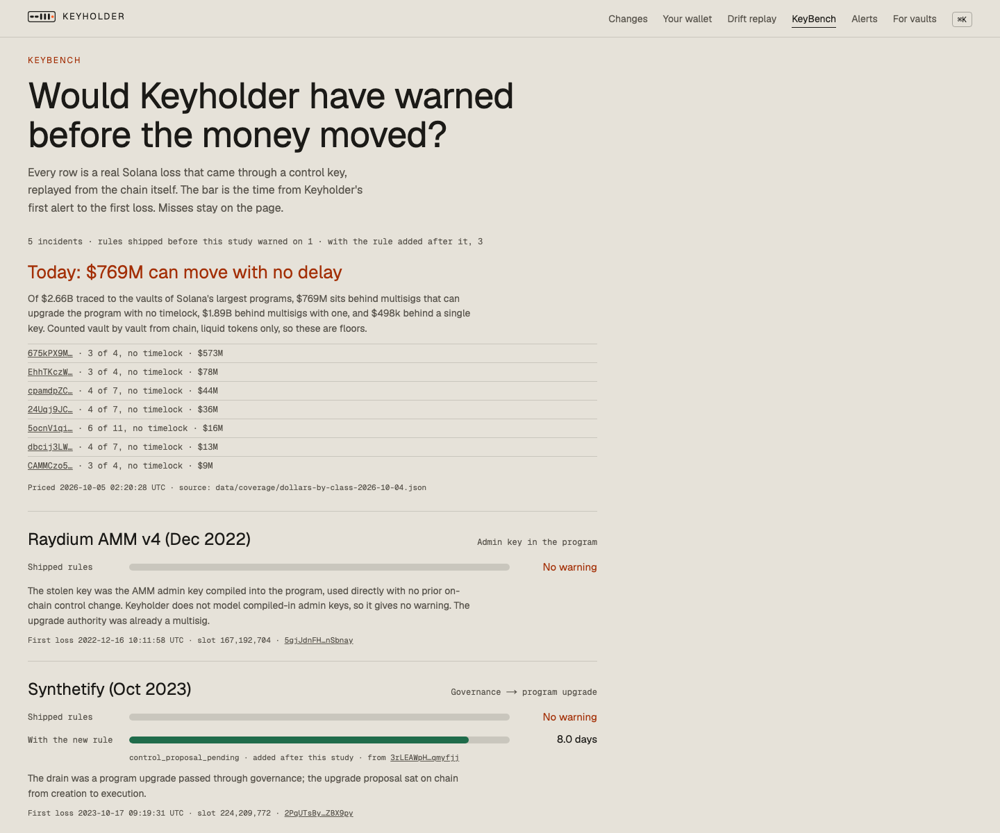

# Keyholder

**Who can change a Solana program, how fast, and did that just change?** Keyholder puts 577 live programs on one of four Control Stages, from "one key can replace the code today" to "cannot change", and lets any program refuse money where control is weak.

[](https://keyholder-ashy.vercel.app)

**Live:** [keyholder-ashy.vercel.app](https://keyholder-ashy.vercel.app) · [Stages](https://keyholder-ashy.vercel.app/stages) · [Open votes](https://keyholder-ashy.vercel.app/stories/open-votes) · [Drift replay](https://keyholder-ashy.vercel.app/replay/drift) · [Build](https://keyholder-ashy.vercel.app/policy) · Film: `design/video/demo/keyholder-film-aligned.mp4`

## What it does

- **Control Stages.** Each program gets Stage 0 (one key), 1 (several keys, no delay), 2 (keys plus a 24 h+ delay) or 3 (cannot change). Every control path counts, not just the upgrade key: Kamino Lend waits 24 h to upgrade, but its admin key is a 4-of-10 multisig with no delay, so it is Stage 1. $769M sits behind programs that can be upgraded with no waiting period.
- **Signer keys.** Keys are reused across multisigs. One key sits on six multisigs behind $1.5B and can act alone on two of them.
- **Open votes.** 53 open multisig votes would change who controls a program or move its funds; one was approved 713 days ago and can still be sent by any signer.
- **Ask Keyholder.** Plain-language questions, answered from the record with the path that sets the stage.
- **require_stage.** An Anchor check (devnet) a program calls before it moves user funds. It refused a real deposit 23 seconds after the target's multisig was weakened.
- **Keyholder's own rule.** Its program changes only through a 2-of-3 Squads multisig with a 48 h timelock. The first upgrade was approved on 2026-10-08, waited 48 h in public and executed on 2026-10-11 ([tx](https://explorer.solana.com/tx/4MRJQhAVatnGeFCLcyf1AGZHAzGz4ciXaJSyG92cfLacXHQ6vUARMNnDxTGCtsiTY7py9xZPNdKVDjDNwZoRCbri?cluster=devnet)).
- **Proof of Control claims.** Teams sign a claim about their controls; Keyholder checks it against the chain.
- **A log no one can rewrite.** Each day's control state is hashed and the hash posted on chain; `verify-anchor` recomputes it.

## KeyBench

Real Solana losses that came through a control key, replayed from the transactions themselves and scored by the same engine the live service runs.

| incident | rules that existed before KeyBench | with the rule added after it |
|---|---|---|
| Drift (Apr 2026, $285M) | 5.6 days before the first drain | 5.6 days |
| Synthetify (Oct 2023) | no warning | 8.0 days |
| BonkDAO BIP #76 (Jul 2026) | no warning | 6.0 days |
| Raydium AMM v4 (Dec 2022) | no warning | no warning |
| Rain card contract (Aug 2026) | no warning | no warning |

The second column comes from `control_proposal_pending`, written after studying these incidents; it is labelled as fitted to them and is not counted as proof until it warns on one it has not seen. Method, corrections to press accounts and open gaps: [`design/keybench/KEYBENCH.md`](design/keybench/KEYBENCH.md).

## Run it

```bash
pnpm install
source scripts/env.sh                      # toolchain: solana 4.3, anchor 1.2
pnpm -r typecheck && pnpm test             # worker, decoder, risk, program tests
cd apps/worker && npx tsx src/keybench/score.ts            # rescore KeyBench from data/keybench
cd apps/worker && npx tsx src/coverage/verify-anchor.ts YYYY-MM-DD   # check a day's anchor
```

Layout: `apps/web` (Next.js site), `apps/worker` (ingest, decode, state, risk, alerts, daily log), `packages/decoder` (byte-level parsers verified on real mainnet accounts), `packages/risk` (rules), `programs/keyholder` (the on-chain check), `scripts/keybench` (chain-read incident and dollar scripts), `evidence/` (dated findings with signatures).

## Honest limits

- KeyBench has 5 incidents; the shipped rules warned on 1. Compiled-in admin keys (Raydium, Pump.fun) are not modelled.
- Dollar figures are floors for the 33 largest programs; most are named by program id, ownership proven on chain only for Raydium and Kamino.
- The daily log starts 2026-10-02; anchors are on devnet.
